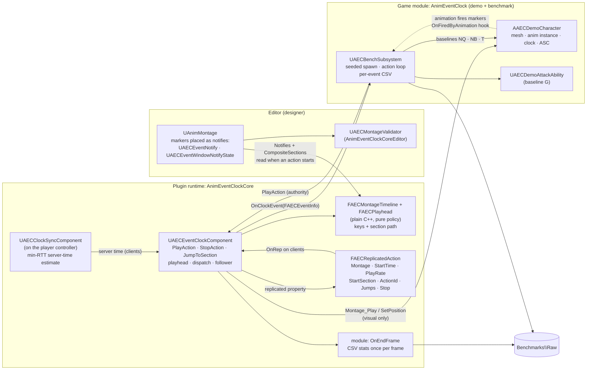

# 02 · System Architecture: AnimEventClock (v1.0, final)

**Phase:** 3 (Architecture), **final**, 2026-11-21. It replaces the Step 0 plan in the roadmap; §14 lists what changed.
**Engine:** UE 5.8.4. Every engine behaviour relied on here is verified in [01b_Research_Findings.md](01b_Research_Findings.md); references like `01b #6` point to its §1 table.
**Rule:** this is the design *before* code (Phase 3). If implementation proves a decision wrong, this file is updated in the same step.

---

## 1. Goals and non-goals

**Goals**
1. Fire gameplay events authored in a montage at the **gameplay time** they were authored for, independent of whether, how often or how late the mesh's animation updates (`01b #1–#5`).
2. Fire each event **exactly once** on every network role: authority, listen host, simulated proxy, autonomous proxy (`01b #6–#8`).
3. On clients, fire on a **latency-compensated** estimate of server time (`01b #9`).
4. Keep the designer's workflow: events are notifies placed in the montage editor. **One source of truth**, no second asset (`01b #10`).
5. Keep the animation as the visual layer: the montage still plays through the engine and is only corrected when it drifts far.
6. Make the timeline logic **testable without a world**, and the whole system switchable on and off in one build for A/B runs.

**Non-goals (v1)**
- Client-predicted actions (GAS prediction keys). v1 actions are started by the authority (§11).
- Re-timing the animation pose or root motion.
- Replacing GAS, Mover or the character movement component.
- Several simultaneous actions per actor (one active action per component, like GAS's one replicated montage).

## 2. The core idea in plain words

An **action** is "this montage, started at this gameplay time, at this play rate, from this section". Everything else follows from those four facts:

```text
position(t) = walk the montage's section path from StartSection for (t − StartTime) × PlayRate seconds
event k is due at the gameplay time t_k where position(t) first passes key k's position
```

- **On the authority**, `t` is the world's game time. Every frame, the component moves a **playhead** from last frame's time to this frame's time and fires every key it passes, in order. A key passed during the frame fires in that frame: **at most one frame late, never early** (SC1).
- **On a client**, `t` is the estimated server time (a small clock-sync component). The replicated action carries `StartTime` in server time, so a client that hears about the action 80 ms late simply starts its playhead 80 ms in: keys already passed fire at once, marked late; later keys fire on time (SC3).
- **Exactly once** follows from the playhead only ever moving forward. Every fired event has an id (action, key, loop pass). Nothing in the animation (URO, budget, corrections, `SetPosition`) can move the playhead back (SC2).
- **The montage follows.** The component also plays the montage on the mesh, starting at the playhead's position, and if the animation falls more than 0.25 s behind or ahead (a mesh the budget allocator disabled, look-ahead drift), it sets the montage back to the playhead's position. Visual corrections never fire gameplay events, because gameplay no longer listens to the animation.

**Rejected alternatives for the core:**

| Alternative | Why we rejected it |
|---|---|
| Force throttled meshes to update every frame | It works, but it removes exactly the saving URO and the budget allocator exist for. It is also not enough on its own: network roles still advance montages on their own schedules (`01b #6, #8`) |
| Use BranchingPoint notifies everywhere | Precise *inside* an update frame, but fires only in update frames (`01b #1`) |
| Advance montages manually from `OnUROSkipTickAnimation` | Still tied to the mesh and its anim instance, uses engine internals, and doesn't touch the network cases |
| Replicate each event as an RPC | Bandwidth grows with events; it still arrives one-way-delay late; reliable RPCs reorder poorly with property replication. A deterministic timeline needs one small struct per action |
| One `FTimerManager` timer per event | Per-event handles to cancel, no sections, no play-rate changes, no clean exactly-once story after a late start. A single playhead per action gives all of these |

## 3. Modules and where they live

```text
D:\UNREAL PORTFOLIO\P06_AnimEventClock\AnimEventClock\          ← the UE project
├── AnimEventClock.uproject
├── Source\AnimEventClock\{Public,Private}\                      ← game module: demo characters + benchmark harness
├── Source\AnimEventClockEditor\{Public,Private}\                ← editor-only game module: demo-asset commandlet
├── Plugins\AnimEventClockCore\Source\AnimEventClockCore\        ← THE REUSABLE SYSTEM (runtime)
├── Plugins\AnimEventClockCore\Source\AnimEventClockCoreEditor\  ← reusable editor tooling: validation of authored events
└── Config\  Content\AEC\ (generated montages)
D:\UNREAL PORTFOLIO\P06_AnimEventClock\Tools\                     ← Python + batch tools (not part of the UE project)
```

| Module | Type | Responsibility | Depends on |
|---|---|---|---|
| `AnimEventClockCore` (plugin) | Runtime | Marker notifies, the montage timeline, the event-clock component, clock sync, cvars, CSV telemetry | `Core`, `CoreUObject`, `Engine` (plus `NetCore` only if S7 uses push-model replication) |
| `AnimEventClockCoreEditor` (plugin) | Editor | `UEditorValidatorBase` that checks authored markers | `AnimEventClockCore`, `DataValidation` (editor plugin, enabled by default) |
| `AnimEventClock` (game) | Runtime | Demo character, anim instance, GAS baseline ability, game mode, player controller, benchmark director | `AnimEventClockCore`, `GameplayAbilities`, `GameplayTags`, `GameplayTasks`, `AnimationBudgetAllocator` |
| `AnimEventClockEditor` (game) | Editor | Commandlet that generates the demo montages (and the validator's seeded-defect set) | `AnimEventClockCore`, `UnrealEd`, `AssetTools` |
| `Tools\` | Python, batch | Build, package, smoke; run batches (with P-core affinity); per-event statistics | — |

**The dependency rule:** game → plugin, editor → runtime, never the reverse. The plugin knows nothing about benchmarks, GAS or the demo.

**Why two editor modules.** Runtime modules must not depend on editor-only modules (`DataValidation`, `UnrealEd`). The validator is reusable, so it lives in the plugin; the commandlet only makes this project's demo assets, so it lives in the game. Phase 4 creates both as empty modules, so the build layout is proven before any code depends on it.

**Naming:** prefix `AEC` for all types; module names are unique in the engine and the project. Public headers follow 5.8's export convention (`#define UE_API ANIMEVENTCLOCKCORE_API` … `#undef UE_API`, as UE5-UpdateBudget does).

## 4. Classes

### 4.1 Plugin `AnimEventClockCore` (runtime)

| Class | Kind / base | Responsibility | Why it exists, and what we rejected |
|---|---|---|---|
| `UAECEventNotify` | `UAnimNotify` | **Authoring marker** for an instant event: `FName EventName`. When the *animation* fires it (`Notify(…)`, `Classes/Animation/AnimNotifies/AnimNotify.h:85`), it only broadcasts a static native comparison hook, `OnFiredByAnimation` | Designers keep placing notifies in the montage editor. The hook lets one run record the animation path (baselines NQ/NB) and the clock path side by side. *Rejected:* a custom notify track type (editor work for no runtime gain) |
| `UAECEventWindowNotifyState` | `UAnimNotifyState` | **Authoring marker** for a window (hit window, combo window): `FName EventName`; `NotifyBegin`/`NotifyEnd` (`AnimNotifyState.h:74, 76`) only feed the same hook | Windows are the most common gameplay use. One class keeps begin/end paired |
| `EAECEventPhase` | `UENUM(BlueprintType)`, `uint8` | `Instant`, `WindowBegin`, `WindowEnd` | One field tells a handler what happened |
| `FAECEventInfo` | `USTRUCT(BlueprintType)` | What a handler receives: `Owner` (S6: one handler object can serve many actors), `EventName`, `Phase`, `ActionId`, `KeyIndex`, `Pass`, `DueTime` (server time), `FireTime`, `LatenessSeconds`, `bInterrupted` (a window closed by a stop, a loop or a jump) | Handlers can use the **exact** due time, for example to rewind a hit trace to it |
| `FAECMontageTimeline` | Plain C++ struct (no UObject) | Built from a `UAnimMontage` when an action starts: sorted keys (name, position, phase, index) from the montage's own `Notifies` (`Classes/Animation/AnimSequenceBase.h:41–43`), and sections (start, end, next) from `CompositeSections`. `Advance(Playhead, DeltaPosition, Out)` walks the section path and outputs every key crossed in `(old, new]` (`[old, new]` right after a start, a loop back or a jump, so a key at a section's start fires on every pass) with its exact offset; a window left without reaching its end (a loop back or a jump from inside it, or a stop) gets a **forced** end crossing, so every begin has exactly one end (S5) | The **policy**, testable with a hand-made timeline and no world (S5 tests). It holds no UObject pointers. *Rejected:* an edit-time baked data asset (a second copy that goes stale, `01b #10`); a per-montage global cache (lifetime bookkeeping before any data says the build cost matters; SC5 measures it) |
| `FAECPlayhead` | Plain struct | Section index, position, loop pass, finished flag, whether the next advance includes its start position, and the open windows | The only mutable state of an action's timeline. Monotonic by construction |
| `FAECReplicatedAction` | `USTRUCT()` | What the network carries: `Montage` (`TObjectPtr`), `StartTime` (server time, `double`), `PlayRate`, `StartSection`, `ActionId` (`uint16`), `StopTime` (`< 0` = running), `Jumps` (up to 8 `{Time, Section}`) | Four facts define an action (§2); jumps and stop make the path reproducible on every machine. *Rejected:* replicating the current position like GAS (`01b #8`): position is stale by the one-way delay and needs threshold corrections |
| `UAECEventClockComponent` | `UActorComponent`, replicated | The **mechanism**: `PlayAction` / `StopAction` / `JumpToSection` (authority), the replicated action and `OnRep`, the playhead, the per-frame dispatch, `OnClockEvent` (`BlueprintAssignable` dynamic multicast), `IsWindowOpen`, the montage follower, telemetry counters | A component attaches to any actor (characters, Blueprint actors, actors without a mesh). Ticks in `TG_PrePhysics`, the same group as the mesh that would have fired the notify, and **only while an action is active**. *Rejected:* an interface (every actor re-implements replication and dispatch); logic inside the character (not reusable) |
| `UAECClockSyncComponent` | `UActorComponent` on the `APlayerController`, replicated | Client→server `ServerRequestTime(ClientTime)` (unreliable), server→client `ClientReportTime(ClientTime, ServerTime)`; keeps the last 8 samples and uses the **minimum-round-trip** one (Cristian's method, raw notes C6). `GetServerTimeSeconds()`; static `AECClock::GetServerTime(const UWorld*)` used by every clock component | The engine's `GetServerWorldTimeSeconds()` lags by the one-way delay (`01b #9`). RPCs need an owning connection, which the player controller has. *Rejected:* reusing `APlayerState` ping (an average over ping buckets, `Private/PlayerState.cpp:43–71`, replicated to other players only as a compressed byte, `Classes/GameFramework/PlayerState.h:56–57, 123–124`; it gives no single round-trip sample to pick the best one from) |
| `FAnimEventClockCoreModule` | `IModuleInterface` | Registers `FCoreDelegates::OnEndFrame` (`Engine/Source/Runtime/Core/Public/Misc/CoreDelegates.h:283`) to publish the per-frame CSV stats **once per frame** from plain counters | UE5-UpdateBudget measured about 50 ns per CSV stat call; per-event calls would show up as cost. *Rejected:* a tickable subsystem just for stats (an extra class) |

**Console variables** (`ECVF_Default`, so they can be set from config and the command line):

| Cvar | Meaning |
|---|---|
| `aec.Enabled` | `1` (default): the clock dispatches. `0`: it doesn't (the montage still plays): the "clock off" configuration for overhead runs |
| `aec.Debug` | `0` off; `1` log every fired event; `2` also draw the open windows above the actor |

**Telemetry:** CSV category `AnimEventClock` with `EventsFired`, `LateEvents`, `ExpiredEvents`, `ActiveActions`, `DispatchUs` (sum of the dispatch cycle scopes this frame), `VisualCorrections`. A stats group `STATGROUP_AnimEventClock` with cycle stats for `Advance` and `Dispatch`.

### 4.2 Plugin `AnimEventClockCoreEditor`

| Class | Base | Responsibility |
|---|---|---|
| `UAECMontageValidator` | `UEditorValidatorBase` (`Engine/Plugins/Editor/DataValidation/Source/DataValidation/Public/EditorValidatorBase.h:28`) | For montages that contain AEC markers: (1) marker without `EventName`; (2) marker outside `[0, length]`; (3) window with duration ≤ 0; (4) two markers with the same name at the same time; (5) marker set to BranchingPoint (a warning: extra cost, no gameplay benefit); (6) a marker placed on a sequence inside a slot track instead of the montage (the clock reads only montage-level notifies). These six are SC7's seeded defects |

### 4.3 Game module `AnimEventClock` (demo + benchmark only)

| Class | Base | Responsibility |
|---|---|---|
| `AAECDemoCharacter` | `ACharacter` | Tutorial mannequin mesh (by path, `01b #13`), a plain graph-less `UAnimInstance`, and from S6 a `UAECEventClockComponent`. The mesh subobject is created as `USkeletalMeshComponentBudgeted` (`FObjectInitializer::SetDefaultSubobjectClass`, `Engine/Source/Runtime/CoreUObject/Public/UObject/UObjectGlobals.h:1459`); budget conditions turn on `a.Budget.Enabled` **and** the world's allocator (S3, 01b #5); budgeted meshes never register on a dedicated server. **Network (S4):** always relevant; its bench index and player flag replicate once; two reliable multicasts carry each action's start and stop with the server's action id; a player's character flies (`MOVE_Flying`, also as the default mode) so its client keeps sending moves |
| `AAECDemoGasCharacter` (S4) | `AAECDemoCharacter`, `IAbilitySystemInterface` | Baseline G only: a replicated `UAbilitySystemComponent` (owner = avatar), the attack ability given on the server, and the `PlayActionMontage` / `StopActionMontage` overrides that activate and stop it (server only). A subclass, so NQ/NB/T runs keep a character without GAS |
| `UAECDemoAttackAbility` | `UGameplayAbility` | Baseline G: plays the action's montage with `UAbilityTask_PlayMontageAndWait::CreatePlayMontageAndWaitProxy` (`…/Abilities/Tasks/AbilityTask_PlayMontageAndWait.h:66`). Server-initiated, instanced per execution; montage and rate in the activation's event data, with a native tag (the owning client needs it, `06` §34) |
| `AAECDemoGameMode` | `AGameModeBase` | Network runs only (`?game=`): sets the player controller class, no default pawn; hands each remote player to the director, which spawns and possesses a demo character for it |
| `AAECDemoPlayerController` | `APlayerController` | S4: tells its client that the run is over (`ClientBenchFinished`); the view stays on the director's camera. S7: owns the `UAECClockSyncComponent` |
| `UAECBenchSubsystem` | `UTickableWorldSubsystem` (Game/PIE only) | The **director**: reads `-AEC…=` values; spawns characters into the three bands from a seed; runs the seeded action loop on the authority through the configured path (NQ/NB direct `Montage_Play`, T timers, G ability, AEC component); records every fire from every path (comparison hook, timers, `OnClockEvent`) with game time, wall clock and frame number; writes the per-event CSV, the per-frame (game time, wall clock) log on servers, the expected-event list, CSV events `BenchStart`/`BenchEnd`; exits when done. **S4:** on a server it waits for its remote players and multicasts each start and stop; on a client (`-AECClient`) it is a **recorder**: it records every replicated character's fires against the server's action ids, starts NQ/NB montages and T timers when a start arrives, logs its own frames, and writes its files when the server says the run is over |

### 4.4 Game module `AnimEventClockEditor`

| Class | Base | Responsibility |
|---|---|---|
| `UAECMakeDemoAssetsCommandlet` | `UCommandlet` | Creates `/Game/AEC/Montages/AM_Attack_{Q,B}` and `AM_Combo_{Q,B}` from `/Engine/Tutorial/SubEditors/TutorialAssets/Character/Tutorial_Idle`, with markers at fixed authored times (Q = Queued, B = BranchingPoint), and `/Game/AEC/ValidatorTests/` with the six seeded defects. Run through the queue: `UnrealEditor-Cmd.exe AnimEventClock.uproject -run=AECMakeDemoAssets` |

## 5. Overview diagram



## 6. Per-frame flow

### 6.1 Authority (standalone, listen server, dedicated server)

```mermaid
sequenceDiagram
  participant W as World tick (TimeSeconds already advanced)
  participant C as UAECEventClockComponent (TG_PrePhysics)
  participant T as FAECMontageTimeline
  participant H as Handlers (OnClockEvent)
  participant M as Mesh / anim instance
  W->>C: TickComponent
  C->>C: Now = world game time; apply jumps due ≤ Now
  C->>T: Advance(Playhead, (Now − LastNow) × PlayRate)
  T-->>C: crossings in order, each with its exact offset
  loop each crossing (in time order)
    C->>H: Broadcast(FAECEventInfo: due, fire, lateness, id)
    H-->>C: may call StopAction / PlayAction / destroy the actor
    C->>C: stop iterating if the action changed or the owner is gone
  end
  C->>M: follower: |montage pos − playhead| > 0.25 s ? SetPosition
  C->>C: finished? → disable tick
```

**Stop during dispatch.** If a handler calls `StopAction` while events are being dispatched, the stop takes effect at the **due time of the event being handled**, so later crossings of that frame (due after it) are not fired. This keeps "cancel on hit" deterministic.

### 6.2 Client

```mermaid
sequenceDiagram
  participant S as Server clock component
  participant N as Replication
  participant C as Client clock component
  participant Y as UAECClockSyncComponent
  S->>S: PlayAction at server time S0 (ActionId k)
  S->>N: FAECReplicatedAction{k, Montage, S0, rate, section}
  N-->>C: OnRep (one-way delay later)
  C->>Y: Now = estimated server time
  C->>C: build timeline; playhead from S0 to Now
  C->>C: keys already passed: fire now (late, ≤ 0.5 s) or count as expired
  C->>C: start montage at the playhead's position
  loop every frame
    C->>Y: Now
    C->>C: advance and dispatch as on the authority (exactly once)
  end
  S->>N: Jumps / StopTime updated
  N-->>C: OnRep: apply at their server times
```

**A new action while one is running** (same component): the old one is advanced to the new action's start time and stopped there, so a client fires the same old-action events as the server did.

### 6.3 Timeline policy, in code-sized pseudocode (the real code mirrors this)

```text
Advance(head, delta, out):                       // delta = gameplay seconds × play rate; nothing unless > 0
  remaining = delta
  while remaining > 0 and not head.finished:
    section = Sections[head.section]
    to = (section.end − head.position <= remaining) ? section.end : head.position + remaining   // snapped onto the end
    if to == head.position and ++emptySteps > 256: head.finished = true; return false      // zero-length loop guard
    for key in keys with head.position < key.position <= to       // (Prev, Cur], the engine's rule ...
                     (or head.position <= key.position when head.includeStart)               // ... [Prev, Cur] after a start/loop/jump
      cross(key, offset = delta − remaining + (key.position − head.position))            // keeps head.openWindows
    remaining −= to − head.position;  head.position = to;  head.includeStart = false
    if to == section.end:
      if section.next == NONE: close every open window here (forced ends); head.finished = true; break
      if next.start == head.position: head.section = section.next   // a continuation
      else: EnterSection(head, section.next)        // a loop back or a skip

EnterSection(head, section):                       // also what JumpToSection does
  close every open window here (forced end crossings, in key order: every crossing of a path is then ordered by (pass, position, key))
  if section.start < head.position (montage time already passed): head.pass += 1
  head.section = section; head.position = section.start; head.includeStart = true
  // the next advance also begins every window that spans section.start (the engine begins a state entered partway)
```

`due time of a crossing = Now − (delta − offset) / max(PlayRate, 0.01)`. The guard counts only steps in a row that make no progress, so a long advance through a normal loop (a late join catching up) never trips it (S5 code review). `JumpToSection` closes the open windows the same way and starts a new pass when it goes back in montage time; `Stop` closes them and finishes the playhead. Key positions are taken with `FAnimNotifyEvent::GetTriggerTime()` / `GetEndTriggerTime()`, not the raw link time, so the engine's tiny start/end trigger offsets (`Private/Animation/AnimTypes.cpp:12–37, 81–94`) apply to the clock exactly as to the notify, and a key authored at 0 behaves the same way on both paths (S5 tests it).

## 7. Defaults and why

| Setting | Default | Reasoning |
|---|---|---|
| Tick group | `TG_PrePhysics` | The mesh ticks there (`01b` §3), so clock events and notifies fire at the same point of the frame and the comparison is fair |
| `MaxLateFireSeconds` | 0.5 s | Larger than the worst start delay tested (100 ms one-way + 10 ms jitter + a frame), so in the test matrix nothing expires (SC3). Older events (an actor that became relevant mid-action) are counted as expired, not fired: a hit 0.5 s late is a bug, not a feature |
| `MaxVisualDriftSeconds` | 0.25 s | Above the largest normal throttling interval (rate 4 at 30 fps = 0.13 s), so URO and the budget allocator never trigger corrections; disabled meshes and look-ahead drift do |
| Clock sync | burst of 5 samples 0.1 s apart, then 1 per second; window of 8 | Fast first estimate; the window tolerates loss and follows game-time offsets after a hitch |
| Play rate | clamped to ≥ 0.01; negative not supported | Reverse playback would need a second crossing rule; no gameplay case in scope |
| `bDriveMontage` | true | The component plays the montage so the pose follows the clock; set false when another system (GAS) already plays it |
| One action per component | — | Matches GAS's single replicated montage; enough for the workload |

## 8. Lifetime and safety rules

| Risk | Rule |
|---|---|
| A handler destroys the owner, starts or stops an action, or jumps during dispatch | Crossings are copied to a local array first. After each broadcast: stop if `!IsValid(this)`, the owner is being destroyed, the action is over, or the path changed (a path serial, moved on by every new action and jump). A jump or a new action from a handler takes effect at the handled event's due time, from where the playhead was at that crossing; the rest of the frame is then advanced on the new path (S6) |
| The montage asset is garbage-collected mid-action | `FAECReplicatedAction::Montage` is a `UPROPERTY` `TObjectPtr`, so the action keeps it alive. The timeline holds only names and floats |
| `EndPlay` with an action running | No events are fired from `EndPlay`; open windows count as closed (`IsWindowOpen` false). Handlers that need a "window closed" signal on destruction use their own `EndPlay` |
| `PlayAction` on a client | v1: logs a warning and returns `INDEX_NONE` (server-initiated actions only, §1) |
| Clock estimate moves backwards on a client (resync) | The playhead never moves back: `Now = max(Now, LastNow)`. No duplicates by construction |
| Replicated jumps arrive out of order or late | Jumps carry their server time and are applied in time order; one already in the past is applied at once (its time is used for due-time maths) |
| A montage with no markers | Empty timeline: the component still drives the montage; no events |
| Calling `Montage_JumpToSection` on the anim instance directly | Bypasses the clock: the follower will correct the pose back. Documented in 07; the API to use is `UAECEventClockComponent::JumpToSection` |
| Game thread only | All dispatch is on the game thread, like BranchingPoint notifies (`01b` §2) |

## 9. One workload, every configuration

The workload must be identical across NQ, NB, T, G and AEC. The director decides **when** each action starts (seeded), and only the **path that reports events** changes:

| Config | Who starts the montage | Who reports events |
|---|---|---|
| NQ / NB | Director → `Montage_Play` on the anim instance | The animation, through `OnFiredByAnimation` |
| T | Same | Timers set at start from the authored offsets |
| G | Director → GAS ability → `PlayMontageAndWait` | The animation (Queued markers) |
| AEC | Director → `UAECEventClockComponent::PlayAction` | `OnClockEvent` |

In single-process runs T and AEC record alongside NQ or NB in the same run (§6.2 of 01), because neither changes the animation (AEC with `bDriveMontage = false` there, so it doesn't play the montage a second time).

## 10. C++ vs Blueprint

| C++ | Blueprint |
|---|---|
| Everything measured: timeline, component, dispatch, clock sync, replication, telemetry, the harness | Placing markers in the montage editor; binding `OnClockEvent`; calling `PlayAction`/`StopAction`/`JumpToSection`; `IsWindowOpen` queries. Per-event Blueprint cost is measured with one Blueprint handler in the overhead batch |

## 11. How it grows into a production game (not built now)

- **Client-predicted actions:** the client starts locally and sends its start timestamp; the server validates it against a window (as the movement component does with client move timestamps) and replicates the corrected start. Exactly-once ids survive the hand-over.
- **Presentation time on clients:** fire cosmetic events at `server time − estimated one-way delay`, matching how replicated movement is shown.
- **Lag compensation:** `DueTime` in every event lets hit detection rewind to the authored moment.
- **Several action slots per actor** (upper body / full body), each with its own playhead.
- **Mesh-less server NPCs:** the clock needs only the montage asset, so a dedicated server can run gameplay events for NPCs with no skeletal mesh ticking at all.
- **GAS integration:** an ability task `WaitClockEvent`, and gameplay tags instead of `FName`.
- **A per-montage timeline cache**, if the overhead batch shows the build cost matters.

## 12. Known limits (stated, not hidden)

1. **Frame quantisation.** Events fire in the first frame past their due time: up to one frame late (33 ms on a 30 Hz server). The exact due time is in the payload.
2. **Late starts on clients** fire events due before arrival late, once; beyond 0.5 s they expire and are counted.
3. **Server time, not presentation time**, on clients in v1 (§11).
4. **Server-initiated actions only** in v1.
5. **`CustomTimeDilation` of the actor is not applied** to the clock (world dilation is). The montage applies it, so the follower corrects the pose if they diverge.
6. **Only montage-level notifies are read**, not notifies on sequences inside slot tracks (the validator flags those).
7. **The follower corrects the pose with `SetPosition`**, which causes a visible pop when it triggers. Rare by design (0.25 s threshold) and counted (`VisualCorrections`).

## 13. Phase 4 layout check

Phase 4 created the four modules empty, plus the `.uproject` plugin list (`AnimEventClockCore`, `AnimationBudgetAllocator`, `GameplayAbilities`), so the build layout, the plugin availability on the launcher engine, the cookability of the tutorial mannequin and the editor `-server` path were all proven before any design-dependent code exists ([09](09_Testing_And_Benchmarks.md), Phase 4 checks).

## 14. Changes from the Step 0 plan (roadmap row 6)

| Change | Why |
|---|---|
| **No edit-time bake**; the timeline is built from the montage at action start; the editor module **validates** instead | Notifies are runtime data (`01b #10`); a baked copy is a second source of truth |
| **Clock-sync component** added | The engine's client server time is not latency-compensated (`01b #9`) |
| **Replicated action with start time + action id** instead of relying on montage replication | No engine path replicates a start time; GAS corrections repeat or skip notifies (`01b #8`) |
| **New role: server with a remote player's character** | The server ticks that pose per client move (`01b #6`) |
| **Timers added as a baseline (T)** | The common workaround; omitting it would be unfair (`01b #12`) |
| **UE-308913 reframed** from "open bug" to "reported in 5.6.1, restructured in 5.8, measured here" | `01b #7` |
| **Gap strength medium**, positioned against Mover, Able and timers | `01b #11` |
| **Dedicated server = editor `-server`**; network runs in real time with P-core pinning | `01b #14`, B-1 |
| **Assets referenced by path**; montages generated by a commandlet | EULA (`01b #13`) |
| No `UAECDemoAnimInstance` (S2) | A plain `UAnimInstance` advances montages and fires notifies; `RootMotionMode` is a public field. An empty subclass would be a class with no reason |
| Default start order "post" (S2) | A montage started after the meshes ticked first advances next frame, so notify errors start at 0; "pre" is kept as the H8 variant |
| Demo characters: shadows off, movement disabled (S2) | "Off screen" must mean "not rendered"; look-ahead runs must not move characters (code review) |
| The validator's seeded-defect montages are made in S8, with the validator | S1 makes only the demo montages, so each step stays small |
| The timeline's crossing range includes its start after a start, a loop back or a jump; windows left early get a forced end; the guard counts empty steps (S5) | A key at a section's start must fire on every pass; every begin needs exactly one end; a crossing cap would end a normal loop during a long catch-up (code review) |
| The director reads its keys through `FAECMontageTimeline::Build` (S5) | One reader: the expected events are exactly the ones the clock will fire |
| The budget conditions enable the world's allocator as well as the cvar (S3) | The cvar alone changed nothing (09 S3-b) |
| Baseline G uses its own character class with the ability system (S4) | NQ/NB/T runs keep a character without GAS; G's montage and rate travel in the activation's event data, which needs a gameplay tag to reach the owning client |
| The director has a client mode, the recorder (S4) | One class for every role keeps the files and their analysis identical; a client never directs, it only follows the server's messages |
| A server waits for its remote players before the warm-up, and outlives its clients at the end (S4) | Every action happens with the client connected; a client whose server disappears would travel to the default map instead of writing its files |
| A remote player's character flies (S4) | It must keep a live movement mode so the client sends moves (the server ticks its pose from them); flying needs no floor and never moves without input |
